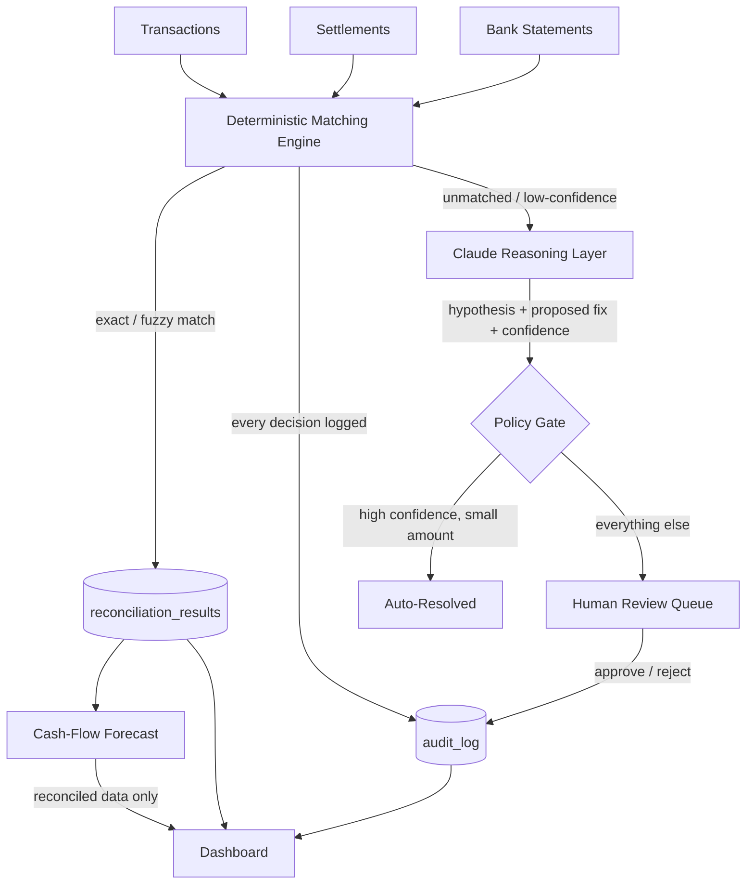

# AutoRecon

**Autonomous reconciliation and cash-flow agent, 

Track 4: AI Finance Controller.**


Finance teams reconcile transactions, settlements, and bank statements by hand in
spreadsheets. Discrepancies — a fee miscalculation, a duplicate credit, a settlement
that never lands — go unnoticed for weeks. **AutoRecon automates the matching, uses
Claude to explain *why* the leftover discrepancies happened, and keeps a human in
the loop for anything the system isn't confident about.**

---

## The problem we're solving

Every business processing payments through Razorpay generates three data streams
that have to agree with each other: what the order system thinks happened, what
Razorpay actually settled, and what landed in the bank account. In practice, a
finance team member opens three spreadsheets, cross-references them by hand, and
flags anything that doesn't match — a process that's slow, error-prone, and easy
to fall behind on as transaction volume grows.

| | **Before — manual reconciliation** | **After — AutoRecon** |
|---|---|---|
| Matching transactions to settlements | Manual VLOOKUPs across exported spreadsheets | Automatic, in seconds, on every run |
| Explaining a discrepancy | Someone has to dig through raw numbers and guess | Claude proposes a specific hypothesis (fee drift, timing lag, duplicate, refund) |
| Deciding what to do about it | Ad hoc, undocumented, inconsistent between reviewers | A deterministic policy gate auto-resolves the obvious cases, routes everything else to a named human reviewer |
| Knowing what happened later | "Someone probably fixed it" | A complete, append-only audit trail — every match attempt, AI proposal, and human decision, in order |
| Seeing cash-flow impact | Reconstructed manually at month-end | A live 7-day forecast built only from verified data |
| Getting the numbers out | Copy-paste into yet another spreadsheet | One-click CSV export |

**The one design decision that makes this trustworthy with real money:** the AI
never decides anything. It explains and proposes; a plain, auditable Python
function — not a model — decides whether to auto-resolve or ask a human. This is
the difference between a demo and something a finance team could actually adopt.

---

## Table of Contents

- [The problem we're solving](#the-problem-were-solving)
- [Core design principle](#core-design-principle)
- [Architecture](#architecture)
- [What's built](#whats-built)
- [Verification status](#verification-status)
- [Quick start](#quick-start)
- [Repository structure](#repository-structure)
- [Documentation index](#documentation-index)
- [Roadmap](#roadmap)

---

## Core design principle

**The LLM never has final authority over money.** A deterministic Python engine
decides every match / no-match outcome. Claude is only ever asked to *explain* the
discrepancies the deterministic engine couldn't resolve on its own, and to *propose*
a fix. A policy gate — plain, auditable Python, not a model — decides whether that
proposal is auto-applied or routed to a human. Every step is written to an
append-only audit log before it takes effect.

This is the single decision that makes the difference between a demo and something
a real finance team could trust with actual money movement.

## Architecture



## What's built

| Phase | Contents |
|---|---|
| **1 — Core reconciliation** | Deterministic three-tier matching engine (exact / fuzzy / unmatched), SQLAlchemy models, synthetic data generator with injected discrepancies |
| **2 — AI reasoning + policy gate** | Claude-powered explanation layer with retry/backoff, the policy gate that's the sole authority on auto-resolution, human review workflow, grounded natural-language query |
| **3 — Frontend** | Next.js + Tailwind dashboard: reconciliation overview, review queue, audit trail, natural-language query, CSV export — see [`frontend/README.md`](frontend/README.md) |
| **4 — Cash-flow forecasting** | Forecasts exclusively from reconciled (verified) data, with confidence bands and settlement-delay anomaly detection |
| **5 — Production infrastructure** | Docker Compose (backend + Postgres + frontend), Alembic migrations, GitHub Actions CI |
| **7 — Security** | API key auth, rate limiting (thread-safe, memory-bounded), CORS controls, request validation, security headers |
| **6 — Roadmap** | Documented, not built — see [`PHASE_6_ROADMAP.md`](PHASE_6_ROADMAP.md) |

Additional hardening beyond the phase structure: structured JSON logging with
request correlation IDs, global exception handling, a real database-connectivity
readiness probe, timezone-safe datetime handling, and mobile-responsive UI. Full
chronological detail in [`HANDOFF.md`](HANDOFF.md).

## Verification status

**99 backend tests pass for real**, executed in the environment that built this —
not just written and assumed correct. The matching engine, policy gate, AI
reasoning layer, forecasting, security, and logging modules are all
dependency-light or dependency-injected, so they run without a database, without
FastAPI, and without the `anthropic` package installed.

Eight real bugs were found and fixed during development — including one that would
have crashed the application the moment it ran against real Postgres in production
(a naive/timezone-aware datetime mismatch). Full list in `CHANGELOG.md`.

The FastAPI router wiring, Docker images, Alembic migration execution, and the
entire frontend were written carefully and reviewed line by line, but have not
been executed end-to-end — the build environment has no network access to install
`fastapi`, `npm` packages, or Docker itself. See
[`PRODUCTION_READINESS.md`](PRODUCTION_READINESS.md) for the complete,
honestly-marked breakdown of verified vs. unverified components, and
[`RUN_AND_DEPLOY.md`](RUN_AND_DEPLOY.md) for exactly what to run locally to close
that gap.

## Quick start

**Fastest path — one orchestrated command:**
```bash
cp .env.example .env    # set ANTHROPIC_API_KEY
pip install -r requirements.txt
./deploy.sh              # or: make deploy
```
Runs the test suite, starts the backend, polls real readiness (not a blind sleep),
seeds demo data, and reconciles it — failing fast with a clear message at whichever
step breaks. Then, in a second terminal:
```bash
cd frontend && npm install && npm run dev
```

**Or via Docker Compose:**
```bash
cp .env.example .env
docker compose up --build
```

Full instructions, troubleshooting, and deployment steps (Railway + Vercel) are in
[`RUN_AND_DEPLOY.md`](RUN_AND_DEPLOY.md).

## Repository structure

```
app/
  main.py                        FastAPI entrypoint — logging, middleware, exception handlers
  database.py                    Engine/session setup (SQLite dev / Postgres prod, connection pooling)
  security.py, security_deps.py  API key auth + rate limiting
  logging_config.py              Structured JSON logging with request correlation IDs
  schemas.py                     Pydantic request/response models (Decimal-safe serialization)
  models/                        SQLAlchemy ORM models
  services/
    matching_engine.py           Pure, dependency-free three-tier matching logic
    policy_gate.py                The sole authority on auto-resolution decisions
    ai_reasoning_service.py      Claude integration — retry, backoff, safe fallback
    forecast_service.py          Cash-flow forecasting from verified data only
    time_utils.py                Timezone normalization (fixes a critical prod bug)
    reconciliation_service.py, ai_analysis_service.py, forecast_bridge_service.py
                                  Bridge DB rows <-> the pure service logic above
  routers/                       FastAPI endpoints
frontend/                        Next.js + Tailwind dashboard (see frontend/README.md)
tests/                           90 tests across every module above
migrations/                      Alembic schema migrations
.github/workflows/ci.yml         Test suite runs on every push
Dockerfile, docker-compose.yml   Containerized deployment
deploy.sh, Makefile              One-command orchestrated local startup
```

## Documentation index

| File | Purpose |
|---|---|
| `SETUP_GUIDE.md` | **New here?** Complete setup from zero, including installing Python/Node/Docker |
| `PRODUCTION_READINESS.md` | Consolidated, honestly-marked verification status |
| `RUN_AND_DEPLOY.md` | Step-by-step setup (assumes tools installed), troubleshooting, live deployment |
| `HANDOFF.md` | Full chronological build log — every phase, every bug found and fixed |
| `CHANGELOG.md` | Version-style summary of changes |
| `NEXT_STEPS.md` | Prioritized action checklist with time estimates |
| `PHASE_6_ROADMAP.md` | Post-buildathon technical roadmap |
| `PITCH.md` | 5-minute demo video script |

## Roadmap

See [`PHASE_6_ROADMAP.md`](PHASE_6_ROADMAP.md) for the documented (not yet built)
post-buildathon plan: multi-transaction settlements, real Razorpay API
integration, incremental reconciliation, multi-currency support, ERP export,
multi-tenancy, and alerting.

---

Licensed under [MIT](LICENSE).
